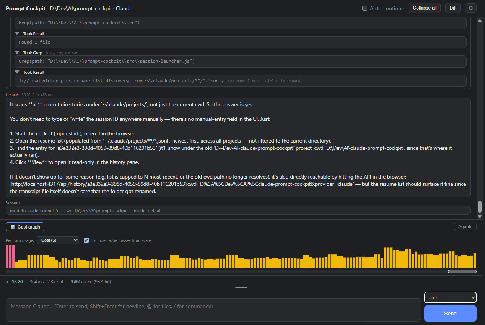

# Prompt Cockpit

A local browser UI for driving a Claude Code, Grok, or Codex session against a project folder. You pick a provider and a directory, type in the compose box, and the cockpit renders the stream, tool calls, diffs, and a live cost/token strip. It talks to the CLIs over their APIs. It does not wrap a terminal.



## What you need

- **Node.js 18+**
- At least one logged-in coding agent on this machine:
  - **Claude**: [Claude Code](https://docs.anthropic.com/en/docs/claude-code) installed, then `claude login`
  - **Grok**: the `grok` binary on `PATH` (or set `GROK_BIN`), then `grok login`
  - **Codex**: the [Codex CLI](https://developers.openai.com/codex/cli/) on `PATH` (or set `CODEX_BIN`) and signed in
- The cockpit does not store API keys. It drives whatever login the CLI already has.

The server binds to `127.0.0.1` only. Do not expose it to the network.

## Run

```
npm install   # first time only
npm start
```

Open the URL printed in the console - `http://localhost:4317/?op=<KEYSTRING>` - not the bare `localhost:4317`. The `op=` value is a per-process operator token; the page reads it once, stores it in `localStorage`, and strips it from the address bar. Without it, `/api/*` calls come back `401`. Set `PORT` if 4317 is taken (`PORT=4318 npm start`).

**If you already have a clone from before 0.1.5:** commit history on `main` was rewritten to scoped-commit messages. Sync with `git fetch origin && git checkout main && git reset --hard origin/main` (rebase or drop any local branches based on the old commits).

## First session

1. Choose **Claude**, **Grok**, or **Codex** in the launcher.
2. Point it at a project folder (type a path, pick a recent one, or Browse).
3. Optionally name the session (needed later if another session will `/ask` it) and pick a model. Leave the model on Default to use the CLI's usual one.
4. Click **Start**.
5. Type a prompt and send. Approvals (plan exit, gated tools) show up as a banner above the compose box.

**Resume** lists past sessions for the selected provider. **Start** resumes live; **View** opens the transcript read-only.

Tabs using different providers can run at the same time. A session keeps the provider it was started with, and transcripts can only be resumed by their original provider.

## Once you are in a session

- **Mode cycle** (Shift+Tab on the compose box, or the mode control) - default / plan / accept-edits and the rest of the CLI's modes.
- **Rewind** on a user turn - opens a new session forked at that point. The original stays. Claude can also revert files when this process started the session fresh. Grok is conversation-only (files on disk stay as they are). Codex does not support rewind yet.
- **`@`** in the compose box - file autocomplete in the project.
- **Cost strip** - spend, tokens in/out, cache hit rate, context used. Grok and Codex have an effort picker instead of Claude's thinking-token budget.
- **`/ask Name: …`** - send a task to another named session in the same folder. The answer comes back as a queued turn.

Settings (gear) covers MCP servers, plugins, permission rules, and UI prefs. On Grok, MCP/plugin toggles go through the Grok CLI (`grok inspect` / `grok mcp` / `grok plugin`) and may need a new session before the agent picks them up.

## Status

MVP1-MVP5 shipped (session in a browser, plan/rewind/`@`/diffs, reconnect, live stats, Grok backend, cross-session `/ask`), plus Codex as a third provider. MVP6-MVP7 (Windows-hosted sessions over SSH, phone approvals) are not started. The Superagent view (below) is shipped on the `feature/superagent` branch.

**Auto-pilot** (scheduled unattended sessions). A pilot is a saved configuration
plus a schedule; each firing starts a *new* session in a configured folder,
sends one stored prompt, runs under a chosen permission mode, and is
force-closed when the work is done. Configured from the header's Auto-pilot
pane (Pilots and Logs tabs); notifications for anything needing a human land in
the bell beside it. A global daily spend cap and a per-pilot failure back-off
(auto-disable after 5 consecutive failures) are the guard rails. On Claude, a
pilot can optionally auto-answer the agent's own `AskUserQuestion` prompts by
taking the recommended option.

Four limitations, by design or by available signal:

- **Pilots do not run while the cockpit is down.** They live and die with the
  process - there is no OS cron registration, deliberately. "Cron" invites the
  opposite assumption, so: closing the cockpit stops every pilot.
- **The spend cap is best-effort.** `costForUsage` returns `null` rather than
  guessing for a model with no pricing entry, so runs on an unpriced model
  contribute nothing to the total and can carry it past the cap. The pane says
  so when it happens.
- **The stall timeout is a runaway backstop, not a hang detector.** Only
  `sdk:message` events advance the progress counter, so a single long tool call
  (a build, a test suite, an `npm install`) looks identical to a hang. The
  default is 60 minutes for that reason; anything shorter force-closes healthy
  runs.
- **Rate-limit back-off is best-effort.** The signal is polled and
  self-clearing, so a short limit window can be missed entirely.

Unattended agents in `acceptEdits` or `bypassPermissions` on a timer means
unsupervised writes to real repositories. Run-now, the run log, the visible
pane and the failure auto-disable are the mitigations; the git-commit-guard
covers only its own narrow case.

See `tests/README.md` for automated vs hand-verified coverage, and `backlog.md` for open follow-ups.

## Superagent view (Plan 6)

The **Superagent** button in the header opens a separate tab (`/?view=superagent`) for the superagent supervisor: you give it an idea and one or more git folders, and it brainstorms, writes a spec and plan, implements, tests and stops at **ready to try**, in worktrees, with a router picking retries. The tab lists jobs, shows phases, branches, tasks, attempts and artifacts, and puts anything that needs you (a question, a ready-to-try job, a stuck job) in a pane on the right. **Accept** and **Stop job** are the only job controls; an answer or Accept sent from a view that is out of date (the job has since moved on to another question or state) is refused rather than applied to what the job needs now. The bell beside the button lists jobs that need you, and with browser notifications enabled a new entry produces one notification across all open tabs, and none again after a Cockpit restart. Clicking an entry focuses the Superagent tab and selects the job without reloading it, so a draft answer or New job form survives.

- **One owner per machine.** The first Cockpit to start takes `~/.prompt-cockpit/superagent/owner.lock` and runs the supervisor. A second Cockpit's tab says `Superagent is running in the Cockpit on port <N>` and links to it; it has no read-only view of its own.
- **Worker sessions are watch only.** Open one from an attempt's **open** link to watch it. The server refuses its session actions, such as mode changes or interrupting, and closing it (403 `ERR_WATCH_ONLY`), and answers typed input, queue changes and delegation on its socket with a `cockpit:watch-only` frame instead of acting on them, because anything you typed would become part of the attempt the code then judges.
- **Each repo once per job.** Naming the same repository twice in one job is refused (`ERR_DUPLICATE_REPO`). Separate jobs on the same repository are allowed; each works in its own worktree and branch.
- **The router needs an `apiKeyHelper`.** Without one in `~/.claude/settings.json` the router is off (the view says `Router off: no apiKeyHelper`) and failed attempts get the code-only retries.
- **Keep `COCKPIT_HOME` short on Windows.** A long path makes every job fail with `ERR_PATH_TOO_LONG`. Jobs and worktrees live under `<COCKPIT_HOME or home>/.prompt-cockpit/superagent`.
- **Not in the view yet:** pause/resume, spend and budgets, answering a budget question, giving feedback, retrying a stuck job, manual mode, a settings modal and stepping into a worker. Each is listed with its later plan in `backlog.md` under "Superagent - planned for later plans".
- **Not probed with a real model in this plan.** `tests/superagent-view-fixture.manual.mjs <cockpitHome> <repoDir>` seeds four jobs into a temp home and checks that nothing would launch before you run a Cockpit on it.

## License

MIT - see `LICENSE`. Use at your own risk.
